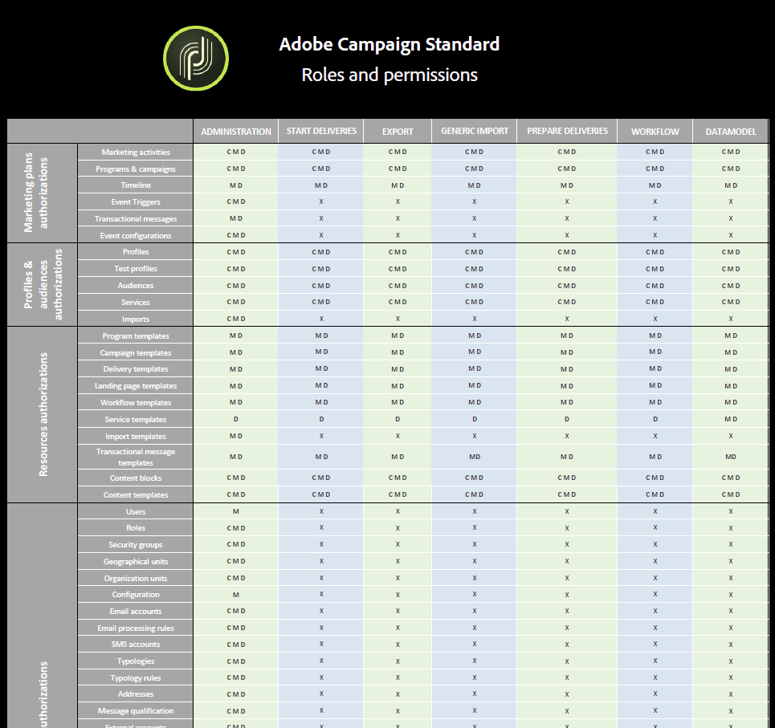

# Lista de funciones{#list-of-roles}

De forma predeterminada, Adobe Campaign ofrece un conjunto de funciones que le permiten definir autorizaciones unitarias asignadas a usuarios y grupos de usuarios.

Combinadas con las unidades organizativas, las funciones proporcionan a los usuarios una vista filtrada de la interfaz y definen su acceso a las diferentes funciones.

Las funciones se pueden administrar desde el menú **[!UICONTROL Administration > Users & Security > Roles]**.

Los derechos predeterminados son:

* **[!UICONTROL Administration]**: Derecho de administración genérico.

  >[!NOTE]
  >
  >Si trabaja con Déclencheur de Experience Cloud, necesita el derecho de **[!UICONTROL Administration]** para poder acceder al menú Déclencheur de Experience Cloud. Para obtener más información sobre los Déclencheur de Experience Cloud, consulte esta [página](../../integrating/using/about-adobe-experience-cloud-triggers.md).

* **[!UICONTROL Datamodel]**: Derecho para ejecutar publicaciones y crear recursos personalizados.
* **[!UICONTROL Generic import]**: Derecho para ejecutar una importación genérica de datos. Para que esto funcione, debe vincular el rol **[!UICONTROL Generic import]** al rol **[!UICONTROL Workflow]**.
* **[!UICONTROL Prepare deliveries]**: Derecho a crear, modificar, preparar y eliminar entregas. Los usuarios con esta función pueden preparar la entrega pero no enviarla.
* **[!UICONTROL Start deliveries]**: Derecho para crear, modificar, preparar, enviar y eliminar entregas.
* **[!UICONTROL Workflow]**: Derecho para gestionar la ejecución de flujos de trabajo (inicio, parada, pausa, etc.). Los usuarios con esta función no pueden enviar una entrega ni siquiera en un flujo de trabajo.

Para obtener más información, consulte la [tabla de funciones y permisos](/help/administration/using/assets/acs_rights.pdf) que detalla las funciones disponibles en la interfaz según las autorizaciones seleccionadas.

**Temas relacionados:**

* [Acerca de la administración de acceso](../../administration/using/about-access-management.md)
* [Administración de grupos y usuarios](../../administration/using/managing-groups-and-users.md)
