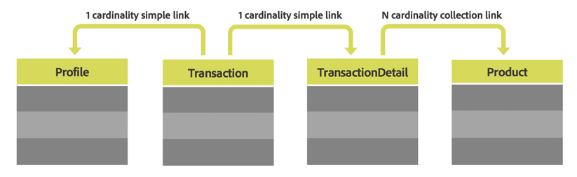

# Recursos personalizados {#custom-resources}

Adobe Campaign viene con un modelo de datos predefinido, donde los datos se definen a través de diferentes recursos. Puede enriquecer el modelo de datos que se proporciona ampliando los recursos para agregar sus propios campos o tablas personalizadas, como las tablas de compras o de productos.

Se puede acceder a los recursos personalizados mediante las API que usan el extremo **/profileAndServicesExt** y el nombre del recurso personalizado.

`https://mc.adobe.io/<ORGANIZATION>/campaign/profileAndServicesExt/<resourceName>/`

>[!NOTE]
>
>Para los recursos que no están listos para usarse, utilice siempre el prefijo <b>&quot;cus&quot;</b> antes del nombre del recurso.

Puede realizar cualquier operación con recursos personalizados, siempre y cuando estén vinculados a la tabla Perfil. Por ejemplo, veamos la estructura de las tablas a continuación:



En ese caso, todos los recursos de las tablas **Transaction**, **TransactionDetails** y **Product** están disponibles siempre que estén vinculados a la tabla **Profile**.

<br/>

***Solicitud de muestra***

Ejemplo de solicitud GET para acceder al recurso profileAndServicesExt ampliado.

```
-X GET https://mc.adobe.io/<ORGANIZATION>/campaign/profileAndServicesExt/\
-H 'Content-Type: application/json' \
-H 'Authorization: Bearer <ACCESS_TOKEN>' \
-H 'Cache-Control: no-cache' \
-H 'X-Api-Key: <API_KEY>' \
```

Devuelve la lista de todos los recursos personalizados vinculados. A continuación, puede utilizar las direcciones URL de los recursos para realizar cualquier tarea de la API descrita en esta documentación.

```
{
"apiName": "resourceType",
"cusProduct": {
        "content": ...,
        "data": "/profileAndServicesExt/cusProduct/",
        "help": "Product",
        "href": "https://mc.adobe.io/<ORGANIZATION>/campaign/profileAndServicesExt/cusProduct/metadata",
        "name": "cusProduct",
        "type": "collection"
    },
"cusTransaction": {
        "content": ...,
        "data": "/profileAndServicesExt/cusTransaction/",
        "help": "Product",
        "href": "https://mc.adobe.io/<ORGANIZATION>/campaign/profileAndServicesExt/cusTransaction/metadata",
        "name": "cusProduct",
        "type": "collection"
    },
    ...
}
```

Para obtener más información sobre la extensión del modelo de datos, consulte la Documentación de Campaign:

* [Conceptos del modelo de datos](../../developing/using/data-model-concepts.md)
* [Ampliación de la API](../../developing/using/about-extending-the-api.md)
* [Definición de vínculos con otros recursos](https://helpx.adobe.com/es/campaign/standard/developing/using/configuring-the-resource-s-data-structure.html#defining-links-with-other-resources)
