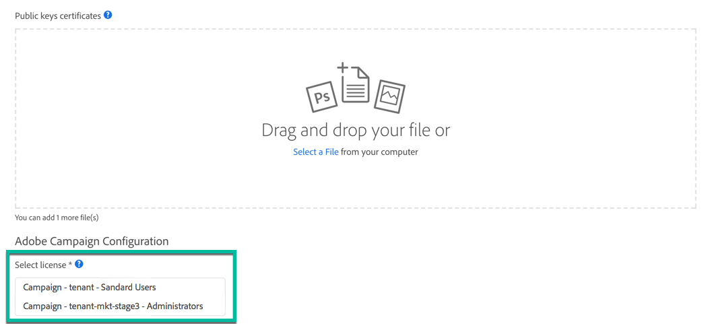

# Configuración del acceso a API {#setting-up-api-access}

El acceso a la API de Adobe Campaign Standard se configura mediante los pasos siguientes. Cada uno de estos pasos se detalla en la [documentación de Adobe Developer](https://developer.adobe.com/developer-console/docs/guides/#!AdobeDocs/adobeio-auth/master/AuthenticationOverview/ServiceAccountIntegration.md).

>[!IMPORTANT]
>
>Para administrar certificados en [Adobe Developer](https://developer.adobe.com/), asegúrate de que tienes los derechos de **administrador del sistema** en la organización o una [cuenta de desarrollador](https://helpx.adobe.com/es/enterprise/using/manage-developers.html) en Admin Console.

1. **Compruebe que tiene un certificado digital** o cree uno si es necesario. Las claves públicas y privadas proporcionadas con el certificado son necesarias en los siguientes pasos.
1. **Cree una nueva integración al servicio Adobe Campaign** en [Adobe Developer](https://developer.adobe.com/) y configúrelo. A continuación, se generan sus credenciales (clave de API, secreto de cliente...).
1. **Cree un token web JSON (JWT)** a partir de las credenciales generadas anteriormente y fírmelo con su clave privada. El JWT codifica toda la información de identidad y seguridad que Adobe necesita para comprobar su identidad y concederle acceso a la API.

   >[!IMPORTANT]
   >
   >JWT (JSON Web Tokens) está actualmente en desuso y se está reemplazando por OAuth. La transición se está llevando a cabo de forma progresiva en las próximas versiones de Campaign. Las credenciales de la cuenta de servicio (JWT) se han marcado como obsoletas y seguirán funcionando hasta el 27 de enero de 2025. Por lo tanto, debe migrar la aplicación o integración para utilizar la nueva credencial de servidor a servidor OAuth antes del 27 de enero de 2025. Se prefiere la autenticación OAuth. Encontrará todos los elementos para migrar de la autenticación JWT a la autenticación OAuth en estas páginas:
   >* [Migración](https://developer.adobe.com/developer-console/docs/guides/authentication/ServerToServerAuthentication/migration/)
   >* [Implementación](https://developer.adobe.com/developer-console/docs/guides/authentication/ServerToServerAuthentication/implementation/)
   >* [Preguntas frecuentes sobre JWT en desuso](https://developer.adobe.com/developer-console/docs/guides/authentication/ServerToServerAuthentication/faqs/)

1. **Intercambie su JWT por un token de acceso** mediante una petición POST. Este token de acceso deberá utilizarse en cada encabezado de sus solicitudes de API.

Para establecer una sesión segura de la API de Adobe I/O de servicio a servicio, cada solicitud a un servicio de Adobe debe incluir en el encabezado Autorización la información siguiente.

```
-X GET https://mc.adobe.io/<ORGANIZATION>/campaign/profileAndServices/profile \
-H 'Content-Type: application/json' \
-H 'Authorization: Bearer <ACCESS_TOKEN>' \
-H 'Cache-Control: no-cache' \
-H 'X-Api-Key: <API_KEY>'
```

* **&lt;ORGANIZATION>**: Este es su ID de ORGANIZACIÓN personal; Adobe proporciona un ID de ORGANIZACIÓN para cada una de sus instancias:

  * &lt;ORGANIZATION> : su instancia de producción,
  * &lt;ORGANIZATION-mkt-stage>: su instancia de fase.

  Para obtener el valor de su ID de ORGANIZACIÓN, consulte con el administrador o con el contacto técnico de Adobe. También puede recuperarla en Adobe I/O al crear una nueva integración, en la lista de licencias (consulte la <a href="https://developer.adobe.com/developer-console/docs/guides/authentication/">documentación de Adobe Developer</a>).

* **&lt;ACCESS_TOKEN>**: Su token de acceso personal, que se recuperó al intercambiar su token web JSON a través de una solicitud POST.

* **&lt;API_KEY>**: su clave API personal. Se proporciona en Adobe I/O después de crear una nueva integración con el servicio de Adobe Campaign.

  

## Solución de problemas

Durante la integración de AdobeIO, si aparece el siguiente error:

```
{ 
"code": 502, 
"message": "Oops. Something went wrong. Check your URI and try again." 
}
```


Póngase en contacto con el administrador o con el contacto técnico de Adobe para comprobar si el parámetro CNAME se crea correctamente.
