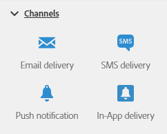

# Acerca de las actividades de canal{#about-channel-activities}

En la paleta, en el lado izquierdo de la pantalla, despliegue la sección **[!UICONTROL Channels]**.

Estas actividades representan los diferentes canales de comunicación disponibles. Puede combinarlas para crear un flujo de trabajo entre canales.

La sección **[!UICONTROL Channels]** ofrece las siguientes actividades:

* [Envío de correo electrónico](../../automating/using/email-delivery.md)
* [Envío de SMS](../../automating/using/sms-delivery.md)
* [Envío de notificaciones push](../../automating/using/push-notification-delivery.md)
* [Envío de correo directo](../../automating/using/direct-mail-delivery.md)
* [Entrega en la aplicación](../../automating/using/in-app-delivery.md)
