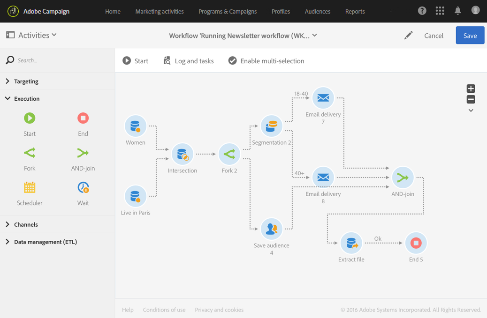

# AND-join{#and-join}

## Descripción {#description}

La actividad **[!UICONTROL AND-join]** le permite sincronizar varias ramas de ejecución de un flujo de trabajo.

## Contexto de uso {#context-of-use}

La actividad **[!UICONTROL AND-join]** solo activa su transición de salida una vez que se activan todas las transiciones de entrada; es decir, una vez que todas las actividades anteriores han finalizado.

## Configuración {#configuration}

1. Coloque varias actividades, como consultas, en el flujo de trabajo para formar, al menos, dos ramas de ejecución diferentes.
1. Arrastre y suelte una actividad **[!UICONTROL AND-join]** en su flujo de trabajo.
1. Conéctelo después de las dos ramas diferentes que desee sincronizar.
1. Seleccione la actividad y, a continuación, ábrala con el botón , en las acciones rápidas que aparecerán.
1. Seleccione el conjunto principal que se mantendrá en la transición de salida. Si no selecciona ningún conjunto, se enviará una población aleatoria desde la actividad.
1. Confirme la configuración de la actividad y guarde el flujo de trabajo.

## Ejemplo {#example}

El siguiente ejemplo muestra dos ramas de flujo de trabajo antes de que se unan a la actividad **[!UICONTROL AND-join]**. La extracción de archivos solo se puede realizar cuando las tres transiciones de entrada de la actividad **[!UICONTROL AND-join]** están habilitadas.

