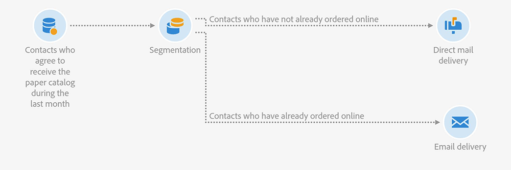

# Emparejamiento de envíos de correo electrónico y correo directo {#coupling-email-direct-mail}

Como especialista en marketing, puede que quiera enviar catálogos por correo directo. En el catálogo en papel, ciertas páginas ofrecen un 10 % de descuento con un código de promoción y un enlace para comprar el producto en el sitio web.

El acoplamiento entre sin conexión y en línea es interesante porque a algunos clientes les gusta más pedir en línea, pero prefieren ver las ofertas de productos en papel.

Este es un ejemplo de plantilla de correo directo que puede utilizar.

Este es un ejemplo de flujo de trabajo que combina canales de correo directo y de correo electrónico.

**Temas relacionados:**

* [Actividad de envío de correo directo](../../automating/using/direct-mail-delivery.md)
* [Acerca del correo directo](../../channels/using/about-direct-mail.md)
