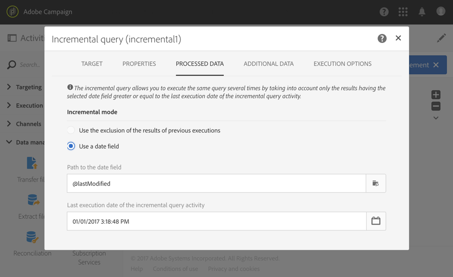

# Consulta incremental{#incremental-query}

## Descripción {#description}

La actividad **[!UICONTROL Incremental query]** permite filtrar y extraer una población de elementos de la base de datos de Adobe Campaign. Cada vez que se ejecuta esta actividad, se excluyen los resultados de las ejecuciones anteriores. Esto permite segmentar solo elementos nuevos.

Puede definir los **[!UICONTROL Additional data]** para la población objetivo mediante una pestaña dedicada. Estos datos se almacenan en columnas adicionales y solo se pueden utilizar para el flujo de trabajo en curso.

La actividad utiliza la herramienta de edición de consultas. Esta herramienta se detalla en una [sección dedicada](../../automating/using/editing-queries.md#about-query-editor).

## Contexto de uso {#context-of-use}

Una **[!UICONTROL Incremental query]** debe estar vinculada a un **[!UICONTROL Scheduler]** para definir la frecuencia de ejecución del flujo de trabajo y, por lo tanto, la consulta.

La pestaña **[!UICONTROL Processed data]**, que es específica de esta actividad, permite realizar vistas de los resultados de las ejecuciones anteriores de la actividad, si es necesario.

La actividad **[!UICONTROL Incremental query]** se puede utilizar para varios tipos de usos:

* Segmentación de personas para definir el destinatario de un mensaje, el público, etc.

* Exportación de datos.

  Puede utilizar una actividad de **[!UICONTROL Incremental query]** para exportar con regularidad nuevos registros en los archivos. Puede resultar útil, por ejemplo, si desea utilizar los datos de registro en herramientas externas de sistema de informes o BI. Puede encontrar un ejemplo completo en la sección [Registros de exportación](../../automating/using/exporting-logs.md).

**Temas relacionados**

* [Caso de uso: Consulta incremental de los suscriptores a un servicio](../../automating/using/incremental-query-on-subscribers.md)

## Configuración {#configuration}

1. Arrastre y suelte una actividad de **[!UICONTROL Incremental query]** en el flujo de trabajo.
1. Seleccione la actividad y, a continuación, ábrala con el botón , en las acciones rápidas que aparecerán.
1. Si desea ejecutar una consulta en un recurso que no sea el de perfil, vaya a la pestaña **[!UICONTROL Properties]** de la actividad y seleccione un **[!UICONTROL Resource]** y una **[!UICONTROL Targeting dimension]**.

   El **[!UICONTROL Resource]** permite refinar los filtros mostrados en la paleta, mientras que la **[!UICONTROL Targeting dimension]**, contextual con respecto al recurso seleccionado, corresponde al tipo de población que desea obtener (perfiles identificados, envíos, datos vinculados al recurso seleccionado, etc.).

1. En la pestaña **[!UICONTROL Target]**, ejecute la consulta definiendo y combinando reglas.
1. En la pestaña **[!UICONTROL Processed data]**, seleccione el modo incremental que desee utilizar para las próximas ejecuciones del flujo de trabajo:

   * **[!UICONTROL Use the exclusion of the results of previous executions]**: se excluyen los resultados de ejecuciones anteriores para cada nueva ejecución.
   * **[!UICONTROL Use a date field]**: las siguientes ejecuciones solo tienen en cuenta los resultados con un valor del campo de fecha seleccionado superior o igual a la fecha de la última ejecución de la actividad **[!UICONTROL Incremental query]**. Puede seleccionar cualquier campo de fecha que pertenezca al recurso seleccionado en la pestaña **[!UICONTROL Properties]**. Este modo ofrece un mejor rendimiento al consultar recursos de gran tamaño, como datos de registro.

     Después de la primera ejecución del flujo de trabajo, puede ver en esta pestaña la última fecha de ejecución que se utiliza en la siguiente ejecución. Se actualiza automáticamente cada vez que se ejecuta el flujo de trabajo. Todavía tiene la posibilidad de anular este valor introduciendo manualmente uno nuevo para que se ajuste a sus necesidades.

   >[!NOTE]
   >
   >El modo **[!UICONTROL Use a date field]** permite una mayor flexibilidad en función del campo de fecha seleccionado. Por ejemplo, si el campo seleccionado corresponde a una fecha de modificación, el modo de campo de fecha permite recuperar datos que se han actualizado recientemente, mientras que el otro modo excluye simplemente las grabaciones que ya estaban segmentadas en una ejecución anterior, aunque se hayan modificado desde la última ejecución del flujo de trabajo.

   

1. Puede definir los **[!UICONTROL Additional data]** para la población objetivo mediante una pestaña dedicada. Estos datos se almacenan en columnas adicionales y solo se pueden utilizar para el flujo de trabajo en curso. En particular, puede añadir datos de las tablas de la base de datos de Adobe Campaign vinculadas a la dimensión de segmentación de la consulta. Consulte la sección [Enriquecimiento de datos](../../automating/using/query.md#enriching-data).
1. Confirme la configuración de la actividad y guarde el flujo de trabajo.

## Enriquecimiento de datos {#enriching-data}

Al igual que para una consulta, puede enriquecer los datos de una **[!UICONTROL Incremental query]**. Consulte la sección [Enriquecimiento de datos](../../automating/using/query.md#enriching-data).
