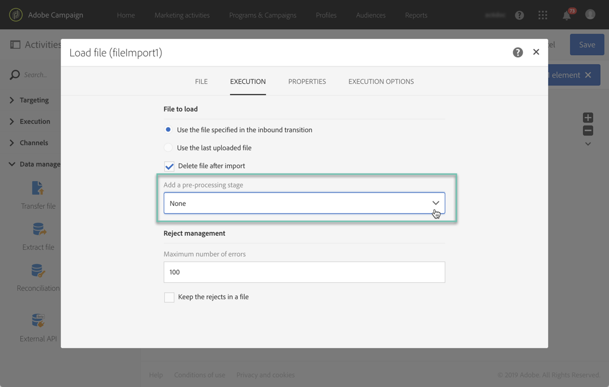
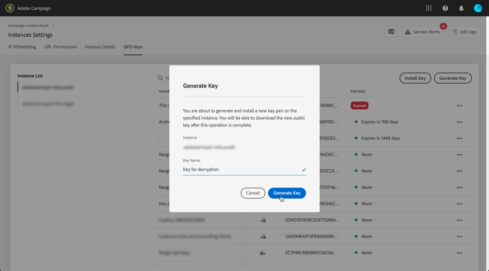
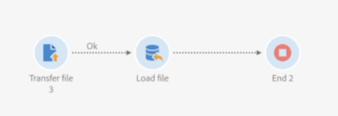
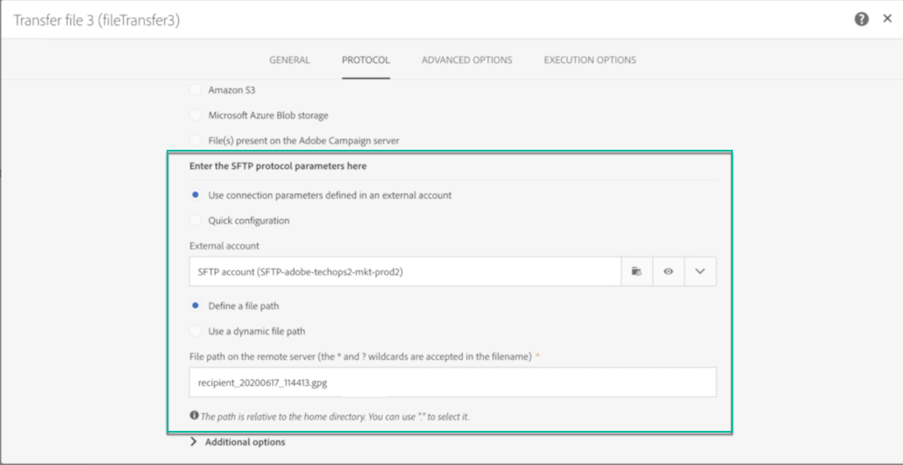
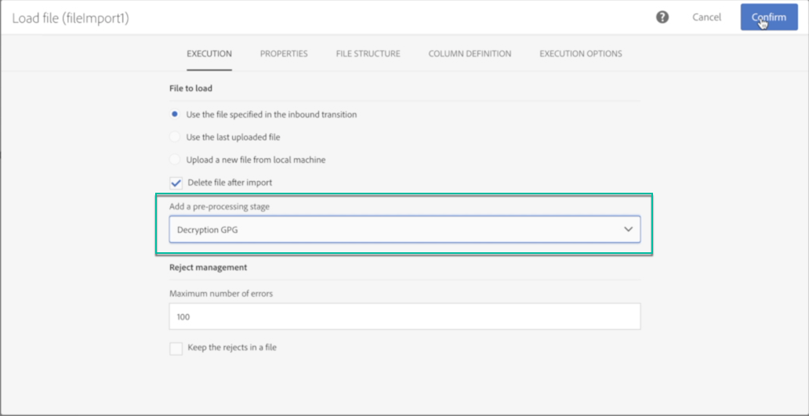
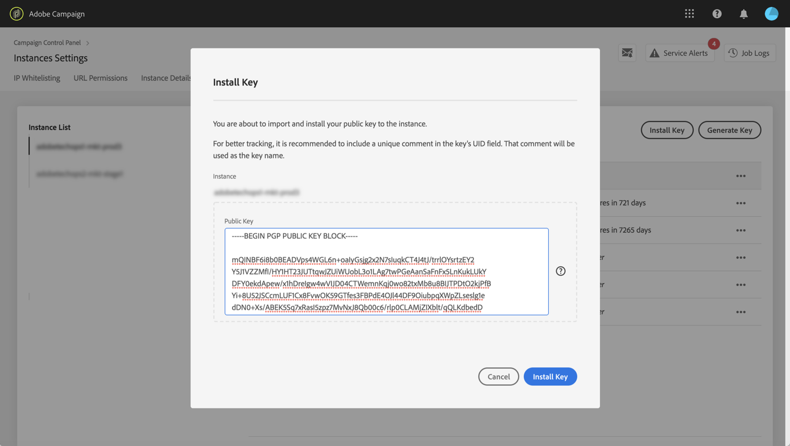
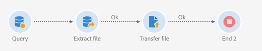
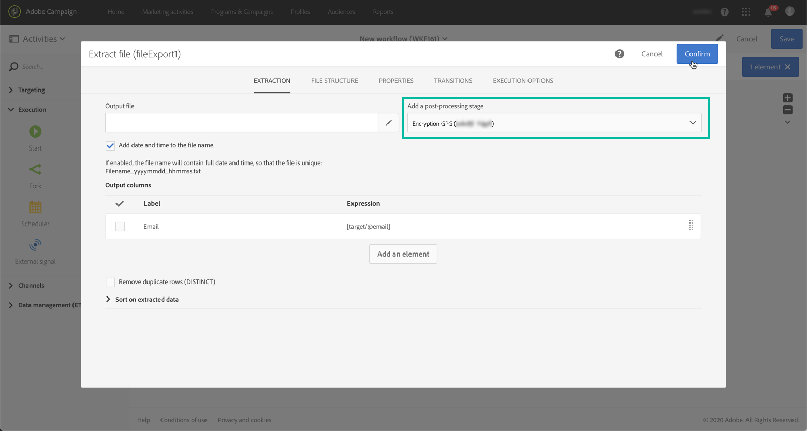
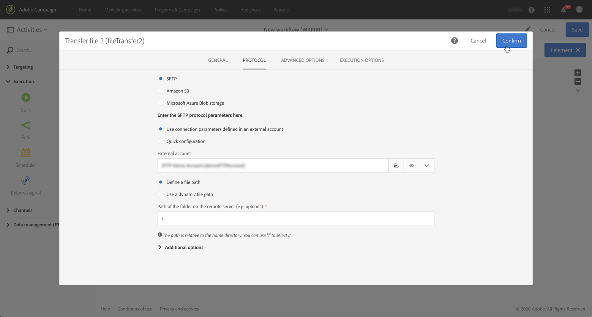

# Administración de datos cifrados {#managing-encrypted-data}

## Acerca de las etapas de preprocesamiento {#about-preprocessing-stages}

En algunos casos, es posible que los datos que desee importar a los servidores de Campaign tengan que cifrarse, por ejemplo, si contienen datos PII.

Para poder cifrar datos salientes o descifrar datos entrantes, debe administrar las claves GPG mediante el [Panel de control de Campaign](https://experienceleague.adobe.com/docs/control-panel/using/instances-settings/gpg-keys-management.html?lang=es).

>[!NOTE]
>
>Panel de control está disponible para todos los clientes alojados en AWS (excepto para los clientes que alojan sus instancias de marketing on-Premise).

Si no puede utilizar el Panel de control de Campaign, debe ponerse en contacto con el Servicio de atención al cliente de Adobe para que le proporcionen los comandos de cifrado y descifrado necesarios. Para ello, envíe una solicitud indicando:

* La **etiqueta** que se mostrará en la interfaz de Campaign para usar el comando. Por ejemplo, &quot;Cifrar archivo&quot;.
* El **comando** que se va a instalar en su instancia.

Una vez procesada la solicitud, los comandos de cifrado/descifrado estarán disponibles en el campo **[!UICONTROL Pre-processing stage]** desde las actividades **[!UICONTROL Load file]** y **[!UICONTROL Extract file]**. Puede utilizarlos para descifrar o cifrar los archivos que desea importar o exportar.

**Temas relacionados:**

* [Carga de archivo](../../automating/using/load-file.md)
* [Extracción de archivos](../../automating/using/extract-file.md)

## Caso de uso: importación de datos cifrados con una clave generada por el Panel de control {#use-case-gpg-decrypt}

En este caso de uso, cree un flujo de trabajo para importar datos cifrados en un sistema externo utilizando una clave generada en el Panel de control de Campaign.

 [Descubra esta función en vídeo](#video)

Los pasos para realizar este caso de uso son los siguientes:

1. Utilice el Panel de control para generar un par de claves (pública/privada). Encontrará los pasos detallados en la documentación [del](https://experienceleague.adobe.com/docs/control-panel/using/instances-settings/gpg-keys-management.html?lang=es#decrypting-data) Panel de control.

   * La clave pública se comparte con el sistema externo, que la utiliza para cifrar los datos que se enviarán a Campaign.
   * Campaign utiliza la clave privada para descifrar los datos cifrados entrantes.

   

1. En el sistema externo, utilice la clave pública descargada del Panel de control de Campaign para cifrar los datos que se van a importar a Campaign Standard.

1. En Campaign Standard, cree un flujo de trabajo para importar los datos cifrados y descifrarlos con la clave privada que se ha instalado mediante el Panel de control de Campaign. Para ello, cree un flujo de trabajo de la siguiente manera:

   

   * Actividad **[!UICONTROL Transfer file]**: transfiere el archivo de un origen externo a Campaign. En este ejemplo, queremos transferir el archivo desde un servidor SFTP.
   * **[!UICONTROL Load file]** actividad: carga los datos del archivo en la base de datos y los descifra utilizando la clave privada generada en el Panel de control.

1. Abra la actividad **[!UICONTROL Transfer file]** y configúrela según sus necesidades. Los conceptos globales sobre cómo configurar la actividad están disponibles en [esta sección](../../automating/using/load-file.md).

   En la ficha **[!UICONTROL Protocol]**, especifique los detalles acerca del servidor sftp y el archivo .gpg cifrado que desea transferir.

   

1. Abra la actividad **[!UICONTROL Load file]** y configúrela según sus necesidades. Los conceptos globales sobre cómo configurar la actividad están disponibles en [esta sección](../../automating/using/load-file.md).

   Añada una fase de preprocesamiento a la actividad para descifrar los datos entrantes. Para ello, seleccione la opción **[!UICONTROL Decryption GPG]** en la lista.

   >[!NOTE]
   >
   >Tenga en cuenta que no es necesario especificar la clave privada que se utilizará para descifrar los datos. La clave privada se almacena en la Panel de control de Campaign, que detecta automáticamente la clave que se debe utilizar para descifrar el archivo.

   

1. Haga clic en **[!UICONTROL OK]** para confirmar esta configuración.

1. Ahora puede ejecutar el flujo de trabajo.

## Caso de uso: cifrado y exportación de datos con una clave instalada en el Panel de control {#use-case-gpg-encrypt}

En este caso de uso, cree un flujo de trabajo para cifrar y exportar datos con una clave instalada en el Panel de control de Campaign.

 [Descubra esta función en vídeo](#video)

Los pasos para realizar este caso de uso son los siguientes:

1. genere un par de claves GPG (públicas/privadas) utilizando una utilidad GPG, luego instale la clave pública en Panel de control. Encontrará los pasos detallados en la documentación [del](https://experienceleague.adobe.com/docs/control-panel/using/instances-settings/gpg-keys-management.html?lang=es#encrypting-data) Panel de control.

   

1. En Campaign Standard, cree un flujo de trabajo para exportar los datos y cifrarlos con la clave privada que se ha instalado mediante el Panel de control de Campaign. Para ello, cree un flujo de trabajo de la siguiente manera:

   

   * **[!UICONTROL Query]** actividad: En este ejemplo, queremos ejecutar una consulta para un destinatario de los datos de la base de datos que queremos exportar.
   * Actividad **[!UICONTROL Extract file]**: codifica y extrae los datos en un archivo.
   * Actividad **[!UICONTROL Transfer file]**: transfiere el archivo que contiene los datos cifrados a un servidor SFTP.

1. Configure la actividad **[!UICONTROL Query]** para destinatario de los datos deseados de la base de datos. Para obtener más información, consulte [esta sección](../../automating/using/query.md).

1. Abra la actividad **[!UICONTROL Extract file]** y configúrela según sus necesidades (archivo de salida, columnas, formato, etc.). Los conceptos globales sobre cómo configurar la actividad están disponibles en [esta sección](../../automating/using/extract-file.md).

   Añada una fase de preprocesamiento a la actividad para cifrar los datos que desea extraer. Para ello, seleccione la clave GPG de cifrado que desea utilizar para cifrar los datos.

   

   >[!NOTE]
   >
   >El valor entre paréntesis es el **comentario** que definió al generar el par de claves mediante la herramienta de cifrado GPG. Asegúrese de seleccionar la clave coincidente correcta; de lo contrario, el destinatario no podrá descifrar el archivo.

1. Abra la actividad **[!UICONTROL Transfer file]** y especifique el servidor SFTP al que desea enviar el archivo. Los conceptos globales sobre cómo configurar la actividad están disponibles en [esta sección](../../automating/using/transfer-file.md).

   

1. Ahora puede ejecutar el flujo de trabajo. Una vez ejecutado, el destinatario de datos de la consulta se exportará al servidor SFTP en un archivo .gpg cifrado.

## Tutoriales en vídeo {#video}

Este vídeo muestra cómo utilizar una clave GPG para descifrar datos.

>[!VIDEO](https://video.tv.adobe.com/v/41351?captions=spa&quality=12)

Este vídeo muestra cómo utilizar una clave GPG para cifrar datos.

>[!VIDEO](https://video.tv.adobe.com/v/41337?captions=spa&quality=12)

Hay disponibles [más vídeos de procedimientos para Campaign Standard aquí](https://experienceleague.adobe.com/docs/campaign-standard-learn/tutorials/overview.html?lang=es).
