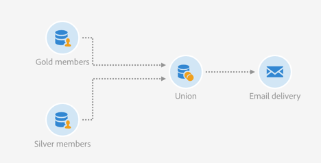

# Unión de dos públicos refinados {#example--union-on-two-refined-audiences}

El flujo de trabajo definido en este ejemplo muestra la unión de dos actividades de **[!UICONTROL Read audience]**. El objetivo de este flujo de trabajo es enviar un correo electrónico a los socios oro o plata que tengan entre 18 y 30 años. Ya se han creado públicos específicos en el sistema para realizar un seguimiento de los miembros oro y plata.

El flujo de trabajo está diseñado de la siguiente manera:

* Una primera actividad [Leer audiencia](../../automating/using/read-audience.md) que recupera la audiencia de miembros oro y la perfecciona seleccionando solo perfiles con edades comprendidas entre 18 y 30 años.
* Una segunda actividad de **[!UICONTROL Read audience]** que recupera el público de miembros plata y lo perfecciona seleccionando solo perfiles de entre 18 y 30 años de edad.
* Una actividad [Union](../../automating/using/union.md) que une poblaciones de ambas actividades **[!UICONTROL Read audiences]** en una población final.
* Una actividad [Email delivery](../../automating/using/email-delivery.md) que envía el correo electrónico a la población proveniente de la actividad **[!UICONTROL Union]**.
