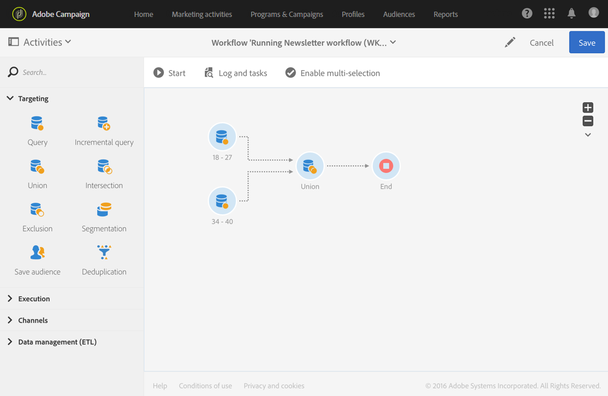

# Unión{#union}

## Descripción {#description}

La actividad **[!UICONTROL Union]** le permite agrupar el resultado de varias actividades en un solo destino.

>[!NOTE]
>
>Los conjuntos no tienen por qué ser necesariamente homogéneos.

## Contexto de uso {#context-of-use}

La actividad **[!UICONTROL Union]** se utiliza para combinar las poblaciones de transiciones entrantes al realizar una segmentación, al definir una audiencia o, por ejemplo, al preparar el destinatario de mensajes.

**Temas relacionados:**

* [Caso de uso: unión en dos audiencias refinadas](../../automating/using/union-on-two-refined-audiences.md)

## Configuración {#configuration}

1. Arrastre y suelte una actividad de **[!UICONTROL Union]** en el flujo de trabajo.
1. Conéctela a las demás actividades que la precedan, como consultas.
1. Seleccione la actividad y, a continuación, ábrala con el botón , en las acciones rápidas que aparecerán.
1. Seleccione el **[!UICONTROL Reconciliation type]** para definir cómo se manejan los duplicados de la confrontación entre poblaciones entrantes:

   * **[!UICONTROL Keys only]**: este es el modo predeterminado. La actividad solo mantiene un elemento cuando los elementos de las distintas transiciones de entrada tienen la misma clave. Puede usar esta opción solo si las poblaciones entrantes son homogéneas.
   * **[!UICONTROL All shared columns]**: los datos se reconcilian sobre la base de todas las columnas comunes con transiciones entrantes. Por lo tanto, debe seleccionar el conjunto principal que se mantendrá en caso de duplicado. Esta opción se puede utilizar si las dimensiones de segmentación de población de entrada son diferentes.
   * **[!UICONTROL A selection of columns]**: seleccione esta opción para definir la lista de columnas a las que desea aplicar la reconciliación de datos. Primero debe seleccionar el conjunto principal (el que contiene los datos de origen) y luego las columnas que se utilizarán para la unión.

1. Marque la casilla **[!UICONTROL Use common additional data only]** si desea mantener solo los datos adicionales que están en todas las transiciones de entrada.
1. Si desea limitar el tamaño de la población final, marque la casilla **[!UICONTROL Limit size of generated population]**. El tamaño se puede especificar en el campo **[!UICONTROL Maximum number of records]**.
1. Si es necesario, administre las [Transiciones](../../automating/using/activity-properties.md) de la actividad para acceder a las opciones avanzadas de la población calculada.
1. Confirme la configuración de la actividad y guarde el flujo de trabajo.

## Ejemplo {#example}

El siguiente ejemplo muestra el resultado de dos actividades de consulta que tienen como objetivo agrupar perfiles de la base de datos de Adobe Campaign que tienen entre 18 y 27 años y entre 34 y 40 años. El resultado contiene todos los perfiles de las dos consultas o el número máximo de registros, si corresponde, según lo especificado en la configuración.

