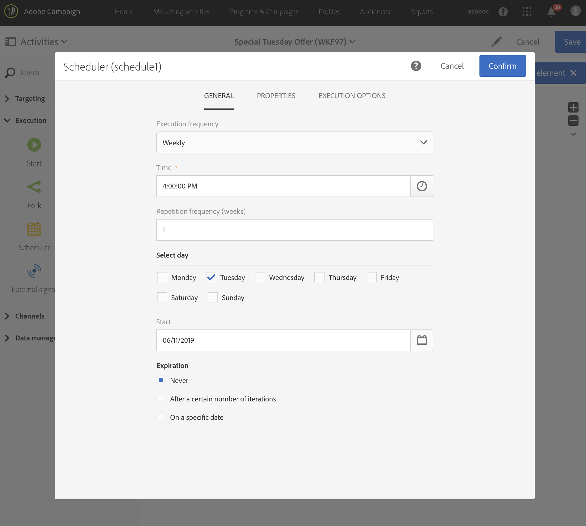

# Creación de una entrega de correo electrónico todos los martes{#creating-email-every-tuesday}

Puede enviar un correo electrónico todos los martes a todos los clientes para ofertas especiales.

1. En **[!UICONTROL Marketing Activities]**, haga clic en **[!UICONTROL Create]** y seleccione **[!UICONTROL Workflow]**.
1. Seleccione **[!UICONTROL New Workflow]** como tipo de flujo de trabajo y haga clic en **[!UICONTROL Next]**.
1. Introduzca las propiedades del flujo de trabajo y haga clic en **[!UICONTROL Create]**.

## Creación de una actividad de planificador{#creating-a-scheduler-activity}

1. En **[!UICONTROL Activities]** > **[!UICONTROL Execution]**, arrastre y suelte una actividad de [Planificador](../../automating/using/scheduler.md).
1. Haga doble clic en la actividad.
1. Configure la ejecución del envío.
1. En **[!UICONTROL Execution frequency]**, seleccione **[!UICONTROL Weekly]**.
1. Seleccione una **[!UICONTROL Time]** y una **[!UICONTROL Repetition frequency]** para los envíos.
1. En **[!UICONTROL Days of the week]**, seleccione **[!UICONTROL Tuesday]**.
1. Especifique un parámetro de **[!UICONTROL Start]** y de **[!UICONTROL Expiration]** para el flujo de trabajo.
1. Confirme la actividad y guarde el flujo de trabajo.

>[!NOTE]
>
>Para iniciar el flujo de trabajo en un **[!UICONTROL Time Zone]** específico, en la pestaña **[!UICONTROL Execution options]**, configure el huso horario del planificador en el campo Huso horario. De forma predeterminada, el huso horario seleccionado es el definido en las propiedades del flujo de trabajo (consulte [Creación de un flujo de trabajo](../../automating/using/building-a-workflow.md)).

## Creación de una actividad de consulta{#creating-a-query-activity}

1. En **[!UICONTROL Activities]** > **[!UICONTROL Targeting]**, para seleccionar destinatarios, arrastre y suelte una actividad [Consulta](../../automating/using/query.md) y haga doble clic en ella.
1. En **[!UICONTROL Shortcuts]** > **[!UICONTROL Profile]**, arrastre y suelte **[!UICONTROL Email]**.
1. Seleccione **[!UICONTROL is not empty]** como operador.
1. En **[!UICONTROL Shortcuts]** > **[!UICONTROL General]**, añada perfiles y seleccione **[!UICONTROL no longer contact by email]** con el valor **[!UICONTROL No]**.
1. Haga clic en **[!UICONTROL Confirm]**.

## Creación de una entrega por correo electrónico{#creating-an-email-delivery}

1. En **[!UICONTROL Activities]** > **[!UICONTROL Channels]**, arrastre y suelte una actividad de [envío de correo electrónico](../../automating/using/email-delivery.md).
1. Haga clic en la actividad y seleccione  para editarla.
1. Seleccione **[!UICONTROL Recurring email]** y haga clic en **[!UICONTROL Next]**.
1. Seleccione una plantilla de correo electrónico y haga clic en **[!UICONTROL Next]**.
1. Introduzca las propiedades de correo electrónico y haga clic en **[!UICONTROL Next]**.
1. Para crear el diseño del correo electrónico, haga clic en **[!UICONTROL Use Email Designer]**.
1. Inserte elementos o seleccione una plantilla existente.
1. Personalice el correo electrónico mediante campos y vínculos.
1. Haga clic en **[!UICONTROL Save]**.

Para obtener más información, consulte [Diseño de un correo electrónico](../../designing/using/designing-from-scratch.md#designing-an-email-content-from-scratch).

**Temas relacionados:**

* [Canal de correo electrónico](../../channels/using/creating-an-email.md)
