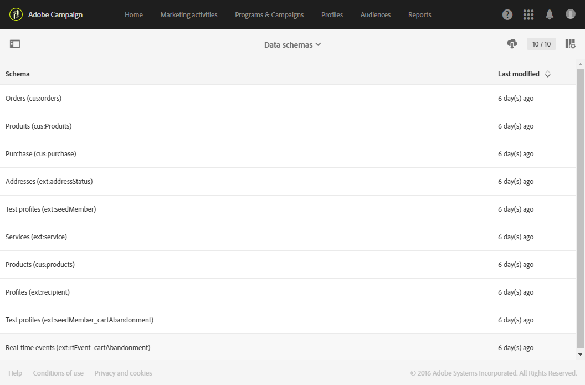
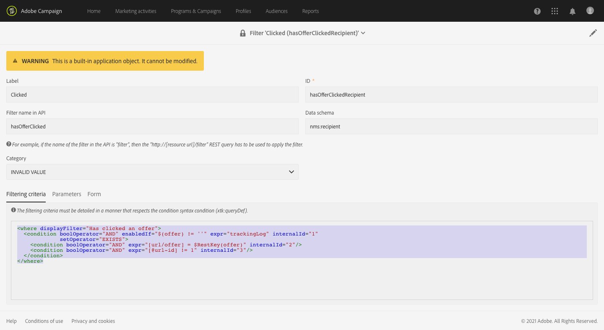

# Monitorización de cambios en el modelo de datos{#monitoring-data-model-changes}

Desde el menú **[!UICONTROL Diagnosis]**, puede ver los objetos técnicos generados por la aplicación para analizarlos.

>[!NOTE]
>
>Las pantallas de este menú son de solo lectura.



Puede ver los siguientes tipos de objetos:

* Esquemas de datos
* Páginas web
* Filtros
* Navegación
* Componentes
* Trabajos por lotes

Puede cambiar la configuración de la lista:

* Puede añadir y quitar columnas.
* Puede definir los nombres de las columnas.
* Puede definir el orden de visualización de las columnas en la lista.
* Puede elegir el orden de los valores en la lista.

Puede filtrar la lista:

* Puede incluir o excluir esquemas de datos nativos, páginas web, filtros y objetos de navegación.
* Puede buscar objetos por su nombre.
* Puede filtrar los trabajos por lotes según su estado, fecha de inicio y fecha de finalización.

Puede descargar la lista mostrada en un archivo en formato TXT con valores separados por comas.

Puede ver los detalles del objeto seleccionado.

Por ejemplo, puede utilizar esta función para ver los criterios de filtrado de los filtros predeterminados. Este ejemplo muestra el código que se muestra para los criterios de filtrado de un filtro predeterminado:

```xml
<where displayFilter="Has clicked an offer">
  <condition boolOperator="AND" enabledIf="$(offer) != ''" expr="trackingLog" internalId="1" setOperator="EXISTS">
    <condition boolOperator="AND" expr="[url/offer] = $RestKey(offer)" internalId="2"/>
    <condition boolOperator="AND" expr="[@url-id] != 1" internalId="3"/>
  </condition>
</where>
```

