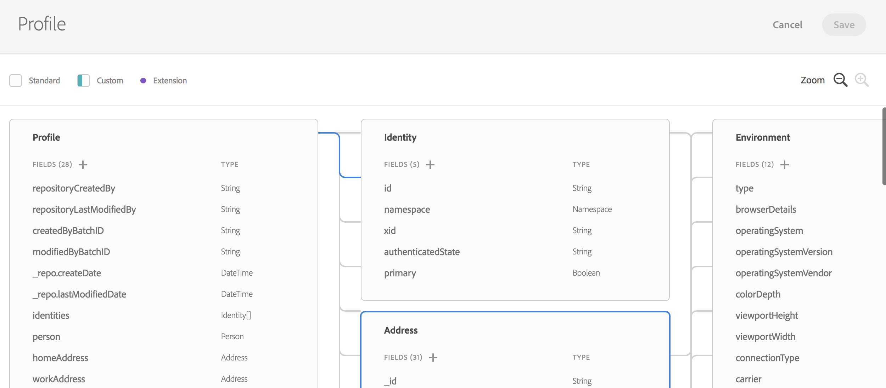

# Información general del modelo de datos de Experience {#experience-data-model-overview}

>[!IMPORTANT]
>
>El conector de datos de Adobe Experience Platform se encuentra en la versión beta, por lo que puede estar sujeto a frecuentes actualizaciones sin previo aviso. Los clientes deben estar alojados en Azure (actualmente en versión beta solo para Norteamérica) para acceder a estas funciones. Si desea acceder, póngase en contacto con el Servicio de atención al cliente de Adobe.

Modelo de datos de experiencia (XDM) es un conjunto estándar de esquemas de datos en los que se pueden ingerir datos para utilizarlos con soluciones y productos de Adobe Experience Platform.

La creación y administración de esquemas XDM está disponible con una API dedicada o con la interfaz de usuario de XDM.

## Espacio de trabajo XDM {#xdm-workspace}

XDM Workspace permite ver, crear y ampliar esquemas de datos.

Para acceder a la interfaz de usuario de XDM, abra Adobe Experience Platform. Acceda a la ventana Modelo de Datos para crear o ampliar un esquema XDM.

Consulte la [documentación completa de XDM Workspace](https://experienceleague.adobe.com/docs/experience-platform/xdm/api/getting-started.html?lang=es).

## API de XDM {#xdm-api}

Puede realizar las siguientes acciones a través de la API de esquema XDM:

* Ver una lista de esquemas existentes
* Ver un esquema específico Ampliar un esquema existente
* Añadir campos a una extensión
* Creación y actualización de un nuevo esquema
* Ver descriptores de esquema
* Crear, actualizar y eliminar descriptores de esquema

Todos los detalles para manipular las llamadas API están disponibles en [Guía para desarrolladores](https://experienceleague.adobe.com/docs/experience-platform/xdm/api/getting-started.html?lang=es).
