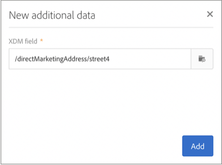

# Personalización de las campañas con atributos de Adobe Experience Platform {#personalizing-campaigns-using-aep-attributes}

>[!IMPORTANT]
>
>El servicio Audience Destinations se encuentra actualmente en fase beta, por lo que puede estar sujeto a frecuentes actualizaciones sin previo aviso. Los clientes deben estar alojados en Azure (actualmente en versión beta solo para Norteamérica) para acceder a estas funciones. Si desea acceder, póngase en contacto con el Servicio de atención al cliente de Adobe.
>
>Los canales **Push** y **en la aplicación** aún no están disponibles para la personalización mediante datos contextuales de Adobe Experience Platform.

Una vez que el flujo de trabajo esté configurado con una [audiencia de Adobe Experience Platform](../../integrating/using/aep-about-audience-destinations-service.md), puede personalizar mensajes con atributos de perfil que existan exclusivamente en el Experience Data Model (XDM).

Para ello, debe agregar estos atributos a la actividad **[!UICONTROL Read audience]**:

1. Abra la actividad **[!UICONTROL Read audience]**. En la ficha **[!UICONTROL Additional data]**, haga clic en el botón **[!UICONTROL Create element]**.

   Tenga en cuenta que la ficha **[!UICONTROL Additional data]** solo está disponible después de seleccionar una audiencia de Adobe Experience Platform.

   

   >[!NOTE]
   >
   >Los tipos de datos de matriz y asignación no son compatibles con esta función. Además, solo se mostrarán en el selector los datos del esquema de unión.

1. Seleccione el campo XDM deseado de la lista y, a continuación, haga clic en **[!UICONTROL Confirm]**.

   

1. Haga clic en el botón **[!UICONTROL Add]** para agregarlo a la lista de datos adicionales.

   

1. Repita estos pasos para cada campo XDM que desee agregar al flujo de trabajo.

   >[!NOTE]
   >
   >Puede agregar un máximo de 20 campos XDM en una actividad **[!UICONTROL Read audience]**.

1. Una vez agregados todos los campos, haga clic en el botón **[!UICONTROL Confirm]** para guardar los cambios. Ahora están disponibles para personalizar las entregas.

Para obtener más información sobre cómo crear y personalizar envíos, consulte la documentación de Campaign Standard:

* [Descubrimiento de canales de comunicación](../../channels/using/get-started-communication-channels.md)
* [Acerca de las actividades de canal](../../automating/using/about-channel-activities.md)
* [Personalización de entregas](../../designing/using/personalization.md)
