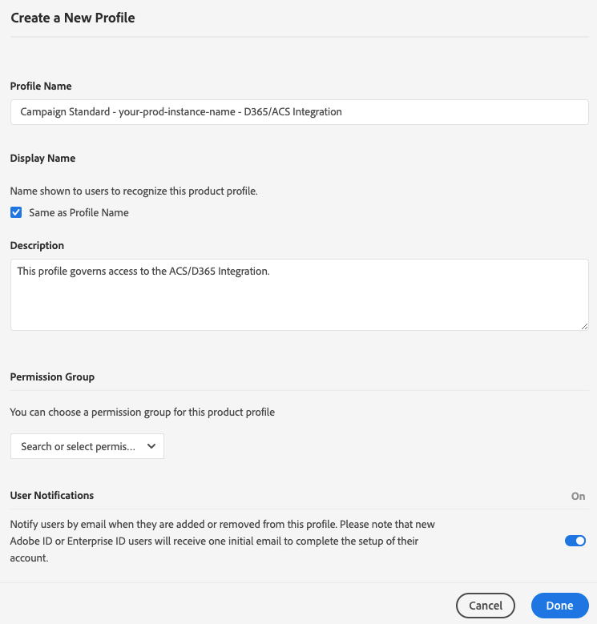
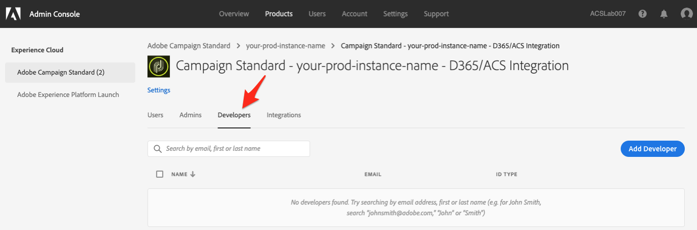

# Acceso a la integración de Adobe Campaign Standard con la aplicación de autoservicio de Microsoft Dynamics 365

Esta configuración requiere que trabaje con un administrador de Experience Cloud (EC) para su organización. Estos son los pasos iniciales necesarios para darle acceso a la interfaz de la aplicación de integración de autoservicio. Una vez que tenga acceso a la herramienta, configurará las conexiones a los datos y el flujo de datos entre Adobe Campaign y Microsoft Dynamics 365.

>[!NOTE]
>
>Debe ponerse en contacto con su representante de Adobe y proporcionar la organización de Adobe Campaign Standard y los nombres de instancia. Se registrará un ticket para solicitar que la aplicación de integración esté habilitada para su organización.

## Añadir un perfil de producto

En esta sección aprenderá a conceder acceso a la integración de Adobe Campaign Standard con la aplicación de autoservicio de Microsoft Dynamics 365. Los usuarios que tengan acceso a su organización en Adobe Experience Cloud no tendrán acceso a la aplicación de autoservicio de integración, a menos que siga los pasos a continuación para concederles acceso.

>[!IMPORTANT]
>
> Estos pasos requieren la función **Administrator** en Experience Cloud para su organización.
>

1. Vaya a https://experience.adobe.com/ e inicie sesión en Adobe Experience Cloud.
1. Acceder a **Admin Console**.

   

1. Haga clic en **[!UICONTROL Products]** para acceder a sus soluciones de Experience Cloud.

   

   >[!IMPORTANT]
   >
   >Los pasos restantes de esta sección se realizarán para cada una de las instancias de Campaign (desarrollo, texto, producción).
   >

1. Haga clic en la primera instancia para configurarla.

   

   La página de instancia debe tener un aspecto similar al siguiente:

   

1. Haga clic en el botón **[!UICONTROL New Profile]** y agregue una nueva entrada denominada: **Campaign Standard - your-prod-instance-name - D365/ACS Integration**

   * Si ve esta entrada en la lista, no es necesario que continúe. Haga clic en **Adobe Campaign Standard** en el menú de la izquierda y verifique las otras instancias de Campaign.

   * Asegúrese de reemplazar &quot;your-prod-instance-name&quot; con el nombre real de la instancia.

1. Puede dejar la lista desplegable **[!UICONTROL Permission Group]** con el valor predeterminado.

1. Si sus entradas tienen un aspecto similar al siguiente, haga clic en el botón **[!UICONTROL Done]**.

   

   Se ha añadido el nuevo perfil de producto.

   

## Concesión del acceso a los usuarios {#add-users-to-profile}

En la página **[!UICONTROL Products]**, seleccione la instancia de Campaign y siga los pasos a continuación:

1. Haga clic en el nuevo perfil que creó anteriormente: **Campaign Standard - your-prod-instance-name - D365/ACS Integration**

   

1. Haga clic en la pestaña **[!UICONTROL Developers]**.

   

1. Haga clic en el botón **[!UICONTROL Add Developer]**

1. Introduzca el nombre o la dirección de correo electrónico del usuario que desea agregar.  Seleccione el resultado que coincida con el usuario.

   Si es la primera vez que se añade un usuario a la organización, introduzca los detalles.

1. Haga clic en **[!UICONTROL Save]** para confirmar.
