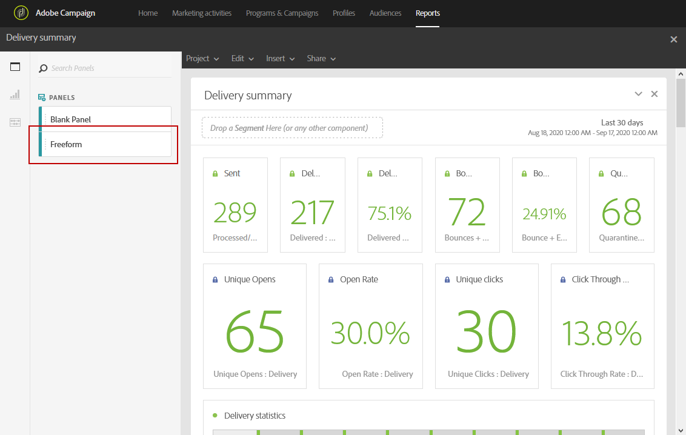

# Adición de paneles{#adding-panels}

## Añadir un panel en blanco {#adding-a-blank-panel}

Para iniciar el informe, puede agregar un conjunto de paneles a un informe predeterminado o personalizado. Cada panel contiene diferentes conjuntos de datos y está compuesto por tablas de forma libre y visualizaciones.

Este panel le permite crear los informes que necesite. Puede agregar tantos paneles como desee en los informes para filtrar los datos con diferentes periodos de tiempo.

1. Haga clic en el icono **Paneles**. También puede agregar un panel si hace clic en la **ficha Insertar** y selecciona **Nuevo panel en blanco**.

   

1. Arrastre y suelte el **panel en blanco** en su panel.

   

Ahora puede agregar una tabla de forma libre al panel para comenzar a segmentar los datos.

## Adición de una tabla de forma libre {#adding-a-freeform-table}

Las tablas improvisadas le permiten crear una tabla para analizar los datos mediante las distintas métricas y dimensiones disponibles en la tabla **Component**.

Es posible cambiar el tamaño de cada tabla y visualización, y estas se pueden mover para personalizar mejor el informe.

1. Haga clic en el icono **[!UICONTROL Panels]**.

   

1. Arrastre y suelte el elemento **[!UICONTROL Freeform]** en su panel.

   También puede agregar una tabla si hace clic en la ficha **[!UICONTROL Insert]** y selecciona **[!UICONTROL New Freeform]** o si hace clic en **[!UICONTROL Add a freeform table]** en un panel vacío.

   

1. En el campo **[!UICONTROL Drop a segment here]**, agregue un(a) **[!UICONTROL Segment]** desde la ficha **[!UICONTROL Components]** a la barra superior.

   

1. Arrastre y suelte elementos de la ficha **[!UICONTROL Components]** en las columnas y filas para generar la tabla.

   

1. Haga clic en el icono **[!UICONTROL Settings]** para cambiar la forma en que se muestran los datos en las columnas.

   

   **[!UICONTROL Column settings]** está compuesto por:

   * **[!UICONTROL Number]**: permite mostrar u ocultar números de resumen en la columna.
   * **[!UICONTROL Percent]**: permite mostrar u ocultar porcentajes en la columna.
   * **[!UICONTROL Interpret zero as no value]**: permite mostrar u ocultar cuando el valor es igual a cero.
   * **[!UICONTROL Background]**: permite mostrar u ocultar la barra de progreso horizontal en las celdas.
   * **[!UICONTROL Include retries]**: permite incluir reintentos en el resultado. Esto solo está disponible para **[!UICONTROL Sent]** y **[!UICONTROL Bounces + Errors]**.

1. Seleccione una o varias filas y haga clic en el icono **[!UICONTROL Visualize]**. Se agrega una visualización para reflejar las filas seleccionadas.

   

Ahora puede añadir tantos componentes como necesite y también añadir visualizaciones para proporcionar representaciones gráficas de los datos.
