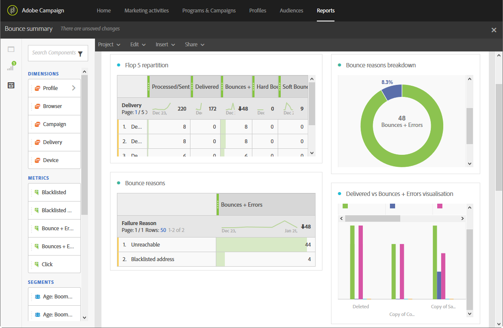

# Resumen de devoluciones{#bounce-summary}

Este informe detalla los errores generales, tanto los errores graves como los leves que se han encontrado durante las entregas, así como el procesamiento automático de las devoluciones (consulte [Comprensión de los errores de entrega](../../sending/using/understanding-delivery-failures.md)).

Cada tabla está representada por números de resumen y gráficos. Puede cambiar cómo se muestran los detalles en sus respectivos ajustes de visualización.

**Flop 5 repartition** enumera las cinco entregas con el mayor número de cuarentenas:

La tabla **Razones de rechazo** contiene los datos disponibles para los tipos de errores que causaron devoluciones en cada envío:

* **[!UICONTROL User unknown]**: tipo de error generado cuando se envía una entrega a una dirección de correo electrónico no válida.
* **[!UICONTROL Invalid domain]**: tipo de error generado cuando se envía una entrega a una dirección de correo electrónico cuyo dominio es incorrecto o ya no existe.
* **[!UICONTROL Unreachable]**: tipo de error encontrado en la cadena de entrega de mensajes, como dominio temporalmente inaccesible.
* **[!UICONTROL Account disabled]**: tipo de error generado cuando se envía una entrega a una dirección de correo electrónico que ya no existe.
* **[!UICONTROL Mailbox full]**: tipo de error generado cuando la bandeja de entrada del destinatario está llena. Hay cinco intentos de enviar el mensaje antes de que se genere este error.
* **[!UICONTROL Not connected]**: tipo de error generado cuando el teléfono móvil del destinatario está apagado o no está conectado a una red en el momento en que se envía el mensaje.

  >[!NOTE]
  >
  >Este tipo de error solo afecta a las entregas de canales móviles.

* **[!UICONTROL Refused]**: tipo de error generado cuando el proveedor de servicios Internet (ISP) rechaza una dirección. Por ejemplo, cuando un software antispam ha aplicado una regla de seguridad.

La tabla **Domain repartition** muestra los problemas generales encontrados durante las entregas según el dominio del destinatario.
