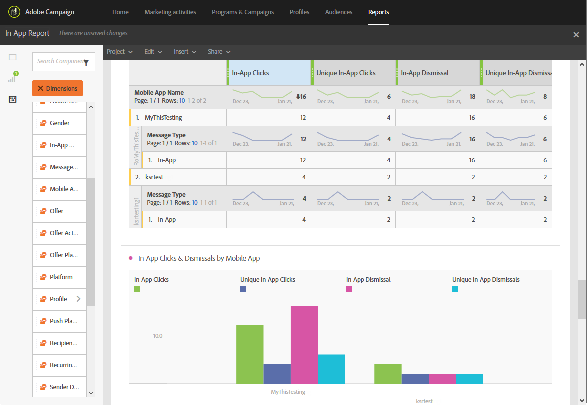

# Informe en la aplicación{#in-app-report}

>[!CAUTION]
>
>Tenga en cuenta que debe arrastrar y soltar las métricas **[!UICONTROL Message type]** en las tablas para dividir los datos según los tipos de entrega, en este caso entregas en la aplicación.

El informe **En la aplicación** proporciona detalles relacionados con los envíos en la aplicación.

Cada tabla está representada por números de resumen y gráficos. Puede cambiar cómo se muestran los detalles en sus respectivos ajustes de visualización.

La primera tabla **Resumen de participación en la aplicación** se divide en tres categorías: por día, por aplicación móvil y por entrega. Contiene los datos disponibles para la reacción del destinatario a la entrega:

* **[!UICONTROL Processed/sent]**: Número total de envíos para la entrega en la aplicación.
* **[!UICONTROL Delivered]**: número de mensajes en la aplicación enviados correctamente en relación con la cantidad total de mensajes enviados.
* **[!UICONTROL Impressions]**: total de mensajes en la aplicación que vieron los destinatarios según si se cumplió el criterio de déclencheur.
* **[!UICONTROL Unique impressions]**: número de impresiones por destinatario.
* **[!UICONTROL In-App click through rate]**: porcentaje de usuarios que hicieron clic en el botón 1 o el botón 2 comparado con los usuarios que vieron el mensaje.
* **[!UICONTROL In-App dismissal rate]**: porcentaje de mensajes en la aplicación que los destinatarios descartaron.

La segunda tabla **Clics y rechazos en la aplicación** se divide en tres categorías: por día, por aplicación móvil y por envío. Contiene los datos disponibles del comportamiento del destinatario por envío:

* **[!UICONTROL In-App clicks]**: número total de destinatarios que hicieron clic en el botón 1 o el botón 2.
* **[!UICONTROL Unique In-App clicks]**: número de veces que los destinatarios hicieron clic en el botón 1 o el botón 2.
* **[!UICONTROL In-App dismissal]**: número total de mensajes que los destinatarios descartaron al hacer clic en el botón Cerrar o descartar automáticamente.
* **[!UICONTROL Unique In-App dismissal]**: número de veces que los destinatarios descartaron un mensaje en la aplicación.
