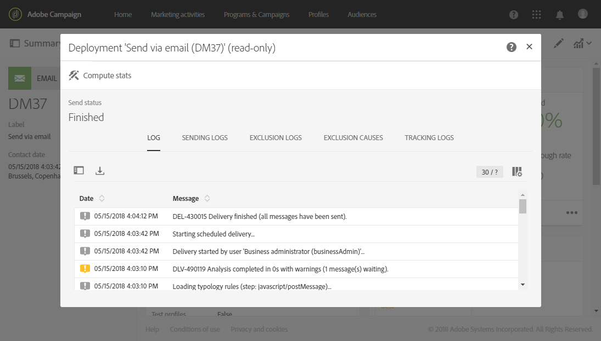

# Supervisión de la entregabilidad{#monitor-deliverability}

A continuación encontrará detalles sobre el informe **[!UICONTROL Delivery throughput]**, así como las diferentes herramientas de monitorización que ofrece Adobe Campaign. Estas son algunas directrices adicionales sobre la monitorización de la capacidad de envío:

* Compruebe regularmente el rendimiento del envío de toda la plataforma para comprobar si es coherente con la configuración original.
* Compruebe que los reintentos estén correctamente configurados (30 minutos para el periodo de reintento y más de 20 reintentos) en plantillas de envíos.
* Compruebe regularmente que el buzón de rechazos es accesible y que la cuenta no está a punto de caducar.
* Compruebe el rendimiento de cada envío para asegurarse de que es coherente con la validez del contenido del envío (p. ej. las “ventas flash” deben entregarse en minutos, no en días).
* Compruebe que el número de errores y nuevas cuarentenas sea coherente con otros envíos.
* Consulte cuidadosamente los registros de envío en detalle para comprobar el tipo de errores resaltados (listas de bloqueados de, problemas de DNS, reglas de correo no deseado, etc.).

## Rendimiento del envío {#delivery-throughput}

Este informe contiene información sobre el rendimiento de entrega de toda la plataforma durante un periodo determinado para medir la velocidad a la que se entregan los mensajes.

Para obtener más información sobre esto, consulte [Rendimiento de los envíos](../../reporting/using/delivery-throughput.md).

Puede configurar los valores mostrados cambiando la escala temporal.

Hay otros informes disponibles, como **[!UICONTROL Delivery summary]** o **[!UICONTROL Non-deliverables and bounces]**. Para obtener más información, consulte [Informes dinámicos](../../reporting/using/about-dynamic-reports.md).

## Monitorización de entregas {#monitoring-deliveries}

El panel de mensajes le proporciona acceso a los registros de envío: **[!UICONTROL Sending logs]**, **[!UICONTROL Exclusion logs]**, **[!UICONTROL Exclusion causes]**, **[!UICONTROL Tracking logs]** y **[!UICONTROL Tracked URLs]**. Estos muestran los detalles del envío, los destinatarios que se han excluido y el porqué, así como la información de seguimiento de aperturas y clics.

Para obtener más información sobre esto, consulte [Monitorización de un envío](../../sending/using/monitoring-a-delivery.md).

## Recepción de alertas {#receiving-alerts}

La característica **[!UICONTROL Delivery alerting]** es un sistema de administración de alertas que permite a un grupo de usuarios recibir automáticamente notificaciones que contengan información sobre la ejecución de sus envíos.

Para obtener más información, consulte [Recibir alertas cuando se produzcan errores](../../sending/using/receiving-alerts-when-failures-happen.md).

<!--
## External tools (#external-tools)

### Signal Spam {#signal-spam}

Signal Spam is a French service which offers anonymized feedback loop reporting for French ISPs (Orange, SFR).

This service allows you to follow the reputation of the French ISPs and track customers' activity evolution.

Signal Spam also provides direct complaints that end users log through a dedicated interface. Those complaints are then quarantined from the email address database.

### 250ok {#solution-250ok}

250ok is a monitoring solution which provides IP and domain denylists, as well as reputation indicators.

The information provided is real-time, which allows for a pro-active assistance. 250ok a complementary solution to the Adobe deliverability internal tools.
-->
